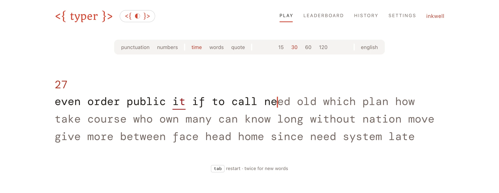
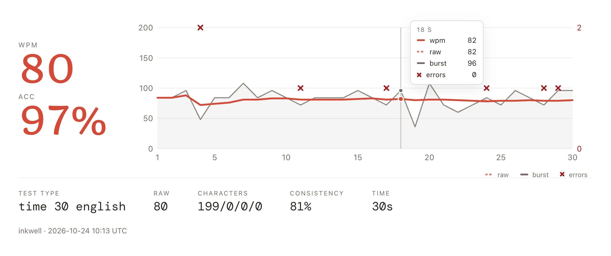
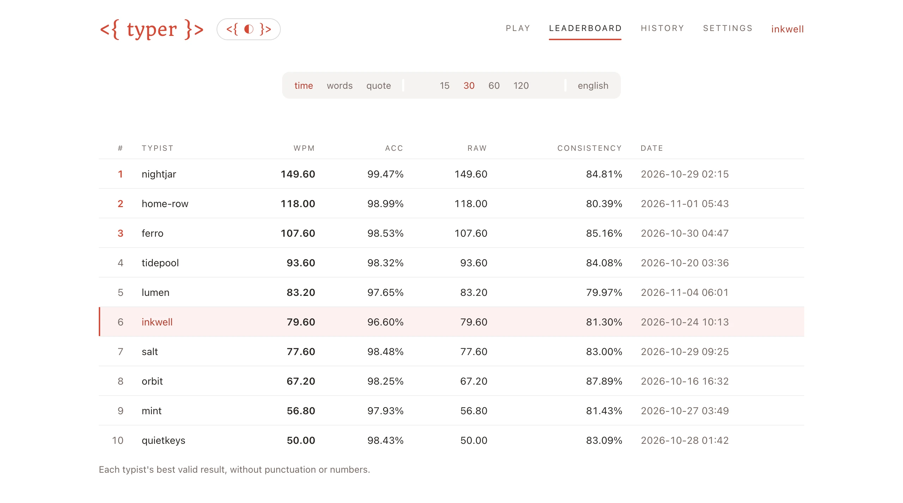
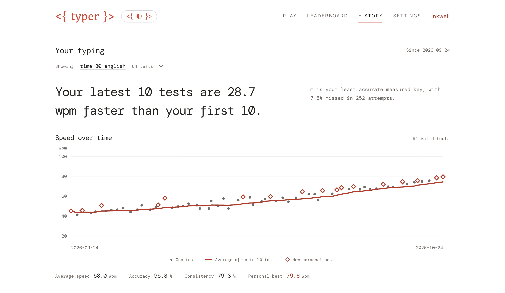
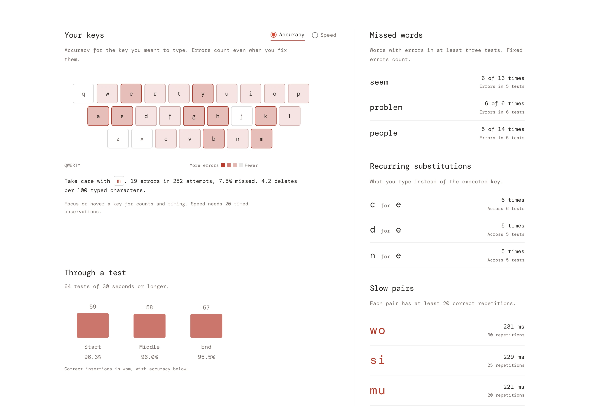
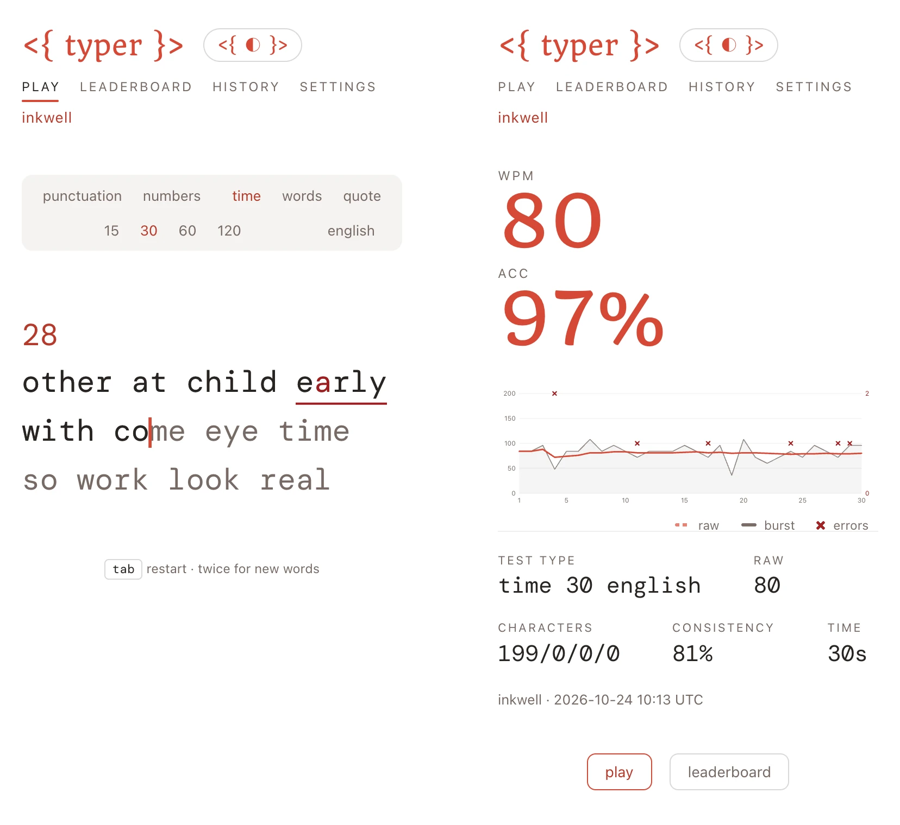
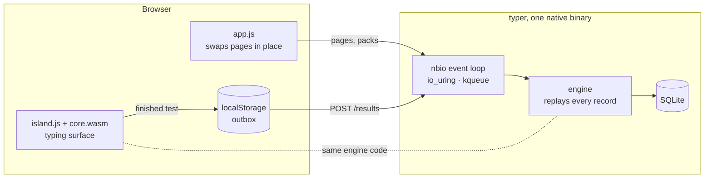

<div align="center">

<a href="https://typer.plosca.ru">
  <picture>
    <source media="(prefers-color-scheme: dark)" srcset="docs/screenshots/hero-dark.webp">
    
  </picture>
</a>

### A typing test with Monkeytype's rules, rebuilt in Odin.

One native server binary and one wasm typing surface.<br>
No npm, no framework, no accounts.

[](https://typer.plosca.ru)
[](https://odin-lang.org)
[](src/island)
[](src/server/db.odin)
[](LICENSE)

**[Try it](https://typer.plosca.ru)** · [Features](#features) · [How it works](#how-it-works) · [Build and run](#build-and-run) · [Deploy](#deploy)

</div>

<br>

## Features

**Monkeytype's numbers.** Wpm, raw, accuracy, consistency and the per-second chart, computed by Monkeytype's rules, which also decide whether a result counts. Hover the chart for any second.

<picture>
  <source media="(prefers-color-scheme: dark)" srcset="docs/screenshots/result-dark.webp">
  
</picture>

**Leaderboards.** Each typist's best valid result per mode, length and language, every one replayed by the server before it counts.

<picture>
  <source media="(prefers-color-scheme: dark)" srcset="docs/screenshots/leaderboard-dark.webp">
  
</picture>

**History.** A finding first, then speed over time within one setup, with each new personal best marked.

<picture>
  <source media="(prefers-color-scheme: dark)" srcset="docs/screenshots/history-dark.webp">
  
</picture>

**Where to improve.** Accuracy and speed per key, missed words, recurring substitutions, slow letter pairs, and pace through a test.

<picture>
  <source media="(prefers-color-scheme: dark)" srcset="docs/screenshots/keys-dark.webp">
  
</picture>

**On a phone** as on a desktop, in light or dark.

<p align="center">
  <picture>
    <source media="(prefers-color-scheme: dark)" srcset="docs/screenshots/phones-dark.webp">
    
  </picture>
</p>

- **Modes.** Time (15, 30, 60, 120 s), words (10, 25, 50, 100) and quotes (short, medium, long, thicc or all), with punctuation and numbers.
- **Content.** 444 word lists and 15,828 quotes, all from Monkeytype. Each browser gets its own shuffled quote queue, so no quote repeats until the pool runs out.
- **Typists without accounts.** Your first finished test gives your browser a typist with a generated name. Rename it on `/me`, where a key link takes the same typist to another device.
- **No result lost.** A finished test waits in an outbox until the server has it, so going offline or closing the tab loses nothing.
- **Themes and motion.** Light, dark or the system's. Smooth motion is optional: the caret glides along a line and finished lines slide out of view.

| Key | Does |
|---|---|
| <kbd>Tab</kbd> | Restarts. During a test you get the same text again¹; before the first key and on the result, new text. |
| <kbd>Esc</kbd> | On the result, repeats the test just done¹. |
| <kbd>Enter</kbd> | Types a line break, shown as ↵, in quotes that have them. |
| <kbd>Shift+Tab</kbd> | Restarts a quote that contains tabs, where <kbd>Tab</kbd> types them. |

¹ As on Monkeytype, a test whose words you have already seen doesn't count. A quote may be retried and still count.

## How it works



- **Engine** (`src/engine`) compiles into both the server and the island: the test state machine, word generation, quote packs, the stats, the result renderer (HTML and SVG) and the record format.
- **Island** (`src/island`, `wasm32-freestanding`) lays the text out and draws it on a canvas, so a keystroke repaints only the words it changed. The caret is a DOM element moved with a CSS transform, so its glide runs on the compositor. `web/island.js` forwards input events, runs the draw commands and keeps the outbox.
- **Pages** are server-rendered HTML that work without script. With it, `web/app.js` fetches the next page on pointer-down and swaps it in place, so nothing reloads and the wasm instance stays alive.
- **Server** (`src/server`) is one `core:nbio` event loop over SQLite. It serves the pages, content-hashed assets precompressed with brotli and gzip, language packs brotli-compressed at build time, quote queue windows, and the result API.

**Results are re-derived, never trusted.** A result is stored as its record: the setup, the target text and every keystroke the engine applied. The server replays each upload through the same engine and ignores any number the client sends. It also checks that a record has the shape the island gives it: a time test ends exactly its length after it began, a words test has exactly its count of words, and a quote result's words are that quote's.

**Identity** is a random 256-bit token in an `HttpOnly`, `SameSite=Lax` cookie, of which the server keeps only the SHA-256. Every POST must come from the site's own origin, and writes are rate-limited per client address.

<table>
  <tr><th align="left">At a glance</th><th align="left"></th></tr>
  <tr><td>Server binary, every asset embedded</td><td>1.3 MB</td></tr>
  <tr><td>Typing surface (<code>core.wasm</code>, English list included)</td><td>46 KB brotli</td></tr>
  <tr><td>JavaScript and CSS</td><td>18 KB brotli</td></tr>
  <tr><td>First visit to the test page, fonts included</td><td>about 100 KB</td></tr>
  <tr><td>Code: engine · server · island · web</td><td>3.2k · 4.4k · 0.9k · 2.6k lines</td></tr>
  <tr><td>Dependencies</td><td>Odin's core library and the system SQLite</td></tr>
</table>

## Build and run

You need Odin at the version in [`.odinversion`](.odinversion), `clang` and `wasm-ld` on your PATH, `brotli`, `gzip` and the SQLite library.

```sh
./build.sh upstream                                # Monkeytype at upstream.commit: word lists and quotes
./build.sh                                         # packs, web assets and core.wasm, then build/typer
build/typer serve /tmp/typer --packs build/packs   # http://127.0.0.1:9334
```

`./build.sh pack` and `./build.sh web` build single stages.

| Command | What it does |
|---|---|
| `typer serve <data dir> [--listen addr] [--packs dir] [--origin url]` | Runs the site. |
| `typer doctor <data dir>` | Checks the database. |
| `typer claim <data dir> <name> [--origin url]` | Creates the typist `<name>` and gives it every result saved before typists existed, which stay off the leaderboard until claimed. Prints the typist's key link. Safe while the server runs. |

## Deploy

Run `scripts/deploy.sh` on the server, from a clean, committed tree. It:

1. builds an `x86-64-v3` binary from scratch;
2. installs it as an immutable release under `~/.local/opt/typer/releases/<rev>`;
3. switches the `current` link and restarts the `typer.service` user unit;
4. checks `/healthz` and the running executable, and rolls back if either fails;
5. keeps the ten newest releases.

<details>
<summary>First deploy</summary>

<br>

1. Copy `deploy/typer.service` to `~/.config/systemd/user/` and enable it.
2. Copy `deploy/typer.caddy` to `/etc/caddy/conf.d/` and reload Caddy.

</details>

<details>
<summary>Migrations and history data</summary>

<br>

Migrations and the replay backfill run before the server listens. The backfill walks result ids in order and commits in batches of 100. A new result saves its analytics and its typist's per-setup totals in the same transaction. Missing or damaged totals are rebuilt from the per-result summaries and never reject a valid upload. The history page reads those totals through a cache bounded by typists and memory, cleared for a typist when they save a result. Its "How these numbers work" section defines every metric and threshold.

</details>

## Credits and license

The test rules, the stats and every word list and quote come from [Monkeytype](https://github.com/monkeytypegame/monkeytype) (GPL-3.0), so typer is GPL-3.0 as well; see [`LICENSE`](LICENSE). The fonts are [DM Mono](https://fonts.google.com/specimen/DM+Mono) and [Quando](https://fonts.google.com/specimen/Quando), both under the SIL Open Font License; see [`web/fonts`](web/fonts).

<sub>Screenshots show a local demo with made-up typists.</sub>
